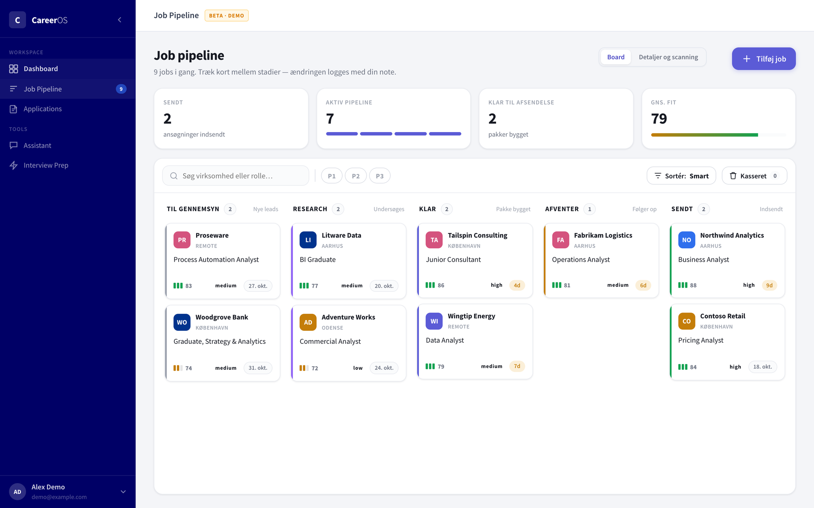
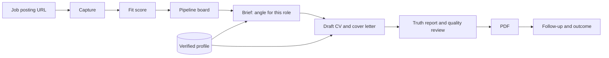
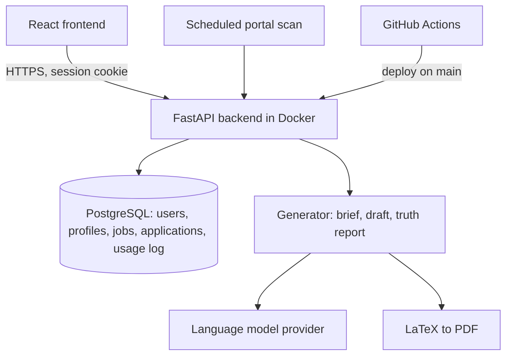

# CareerOS

A job search platform that keeps track of your applications and drafts CVs and cover letters from a verified profile, so the text never claims more than you can back up.

> **This is a case study with selected source files.** CareerOS is my own product project and the repository holds personal data, so the full code is private. A few source files are in [`code/`](code/). The screenshot shows the real application running locally with demo data.

| At a glance | |
|---|---|
| **Type** | Own product, built alone |
| **Period** | March to July 2026 |
| **Status** | Works end to end and is deployed. So far I am the only user. The product is on the shelf for now while other work takes priority. |
| **Stack** | React, FastAPI, PostgreSQL, LaTeX, Docker, GitHub Actions |

## The problem

A good application takes hours, and most of that time goes to restating the same facts in the language of a new job posting. Language models can do that restating quickly, but they also inflate: a course you took once becomes "extensive experience".

## Why it matters

In a CV, inflation is not a style problem. One claim that falls apart in an interview costs more than the whole document was worth. A tool that writes faster and less truthfully makes the job seeker worse off.

## What I built

A web application that follows a job from first sight to final outcome.



*The pipeline board in the real application, full screen, with a demo account and invented companies. The interface is in Danish. Columns run from new leads to sent applications, and each card shows fit score, priority and deadline.*

- **Capture.** A posting is saved from its URL as text, HTML and PDF, so an application can always be checked against what the employer actually wrote.
- **Score and sort.** Each lead gets a fit score against the user's profile. Leads that have been captured but not yet looked at are kept apart from active applications.
- **Draft.** A short brief picks the angle for the role. The CV and cover letter are then written in the posting's language from reusable profile text in Danish and English, and typeset as PDFs.
- **Check.** Each package comes with a truth report and a quality review before the user sees it.
- **Revise.** A chat panel tied to the job can rewrite a section on request.
- **Onboard.** New users upload what they already have: CVs, diplomas, transcripts. The system proposes profile entries from them, and the user confirms before anything is saved.

## My role

This is my own idea, and I built it alone. It started as a handful of scripts for my own applications. I am an economist, not a software engineer. My work was the product and its rules, and the code was written by AI coding agents.

What I did:

- **Defined the product.** What a user does, in which order, and where a person has to decide.
- **Designed the profile model.** The split between raw notes, curated text and verified claims, described under key decisions.
- **Wrote the quality rules.** For example that a skill marked as "developing" must never be written as established, and that every package is reviewed against a checklist before it is shown.
- **Used it.** My own job search is where most quality problems surfaced.
- **Took outside feedback.** A career advisor's comments on my CV became changes to the templates and the writing rules.
- **Diagnosed weak results.** A brand-new profile produced a much thinner CV than mine. I had the generation pipeline audited, chose the direction from the findings, and had onboarding rebuilt around it.

How AI agents were used: implementation, database migrations, tests and documentation, working from written directives with acceptance criteria, dependencies and a status. I track estimated against actual effort per directive.

## How it works



| Part | How |
|---|---|
| Frontend | React, with its own design system |
| Backend | FastAPI on PostgreSQL, with versioned migrations |
| Login | Email and password, magic link, or Google |
| Language models | A user's own API key is stored encrypted. Every call is logged with its cost. |
| Documents | LaTeX templates compiled to PDF |
| Hosting | Backend in Docker on a virtual server, managed database, automatic deploys |

## Key decisions

**Three layers of personal information.** Raw notes and work logs are captured freely. Curated text is written from them. Verified claims say what may be stated and how strongly. Only the last two feed a CV. That separation is what keeps the output trustworthy, and it is the part of the design I would defend first.

**From files to a database in reversible steps.** The first version kept everything in CSV and JSON files. Moving to PostgreSQL for several users was done as a staged cutover with migration scripts and frozen snapshots, so each step could be undone.

**Cost is a product decision.** Every language model call is logged per user, and a rolling weekly budget per user can warn or block on the server. A product that calls a paid service on a user's behalf needs a ceiling before it needs more features.

**Security problems are fixed and written down.** The revise feature had a flaw where a crafted instruction could make the generator fall back to the default profile and write that profile's data into the caller's own application. It was closed in two places and covered by tests. I would rather show that than pretend it never happened.

## Architecture



## Selected implementation

- [`code/job_scoring.js`](code/job_scoring.js) scores a posting against a profile on seven weighted dimensions. The weights live in [`code/scoring_weights.json`](code/scoring_weights.json), shared by frontend and backend so both show the same number.
- [`code/budget.py`](code/budget.py) is the rolling weekly budget for language model spend per user, with the three modes off, warn and block.

```json
{
  "skill_match": 3,
  "title_alignment": 2,
  "location_fit": 1.5,
  "seniority_match": 1.5,
  "role_clarity": 1,
  "company_signals": 1,
  "work_type_fit": 1
}
```

## Scale

About 19,000 lines of Python and 18,000 lines of JavaScript, 280 commits, and about 150 automated API tests.

## What I learned

- The difficult part of a writing tool is deciding what it may say. Once that is settled, the writing follows.
- Being the first user finds problems. Being the only user hides them: the audit showed how much of the output still leaned on text written for my own profile.
- Moving storage is much easier when every step can be reversed.

## Where it stands

Only I have used it so far, for my own applications. How well onboarding works for people whose background looks nothing like mine is the least tested part. The project is parked for now, with a written version plan for taking it from a single user to an open beta if I pick it up again.

---

© Oliver Bruhn. Text and images may not be reused without permission.
